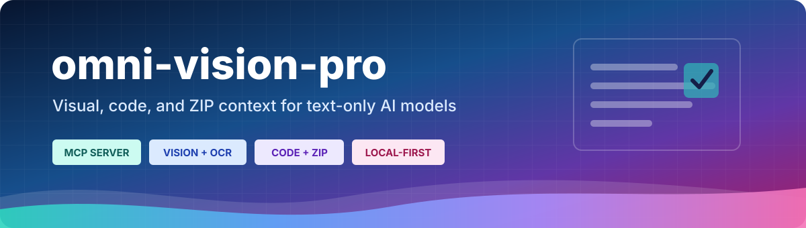
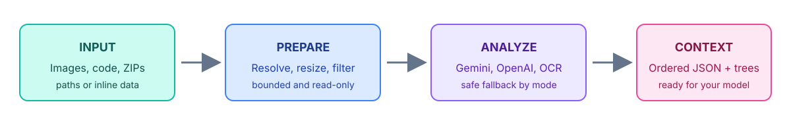

<p align="center">
  
</p>

<p align="center">
  <strong>Give DeepSeek, Codex, OpenCode, Claude, VS Code, and other text-only models the context they cannot see.</strong><br>
  Resolve screenshots, inspect source trees, and read ZIP archives through one local MCP server.
</p>

<p align="center">
  <a href="https://www.npmjs.com/package/omni-vision-pro"></a>
  <a href="https://nodejs.org/"></a>
  <a href="https://modelcontextprotocol.io/"></a>
  <a href="https://github.com/0xnurrabby/omni-vision-pro/blob/main/LICENSE"></a>
</p>

<p align="center">
  <a href="#quick-start">Quick start</a> &nbsp;|&nbsp;
  <a href="#what-it-does">What it does</a> &nbsp;|&nbsp;
  <a href="#manual-client-setup">Manual setup</a> &nbsp;|&nbsp;
  <a href="#privacy-and-safety">Privacy</a>
</p>


## Quick start

You need Node.js 20.10 or newer. No API key is required for local OCR.

### Free local setup from an AI chat

Paste this command into Codex, OpenCode, Claude Code, or Cursor chat and ask it to run it:

```bash
npx --yes omni-vision-pro@latest setup --yes --provider ocr
```

That one command detects supported clients, installs a private pinned runtime, writes the MCP configuration, and verifies all three tools. Images stay local in OCR mode.

### Gemini or OpenAI setup from an AI chat

1. Copy your Gemini or OpenAI API key to the clipboard.
2. Paste this single command into the AI chat and ask it to run it:

```bash
npx --yes omni-vision-pro@latest setup --yes --from-clipboard
```

The installer recognizes the copied key, selects Gemini or OpenAI automatically, saves it in Omni's private `.env`, configures detected clients, and runs an MCP health check.

The key is never placed in chat text, command arguments, shell history, or client JSON/TOML. Clipboard mode reads only a value that looks like a Gemini or OpenAI key and never prints it.

> Windows and macOS clipboard support works out of the box. Linux needs `wl-paste` or `xclip`.

After setup, restart or reload the client and ask:

```text
Use omni-vision-pro to analyze this screenshot. Return the visible text, UI hierarchy, layout, colors, interactions, accessibility issues, and reusable components.
```

### Guided terminal setup

If you prefer prompts in the terminal, run:

```bash
npx --yes omni-vision-pro@latest setup
```

Check the result at any time:

```bash
npx --yes omni-vision-pro@latest doctor
```

For a manual cloud setup, run `npx --yes omni-vision-pro@latest setup --provider gemini`, `--provider openai`, or `--provider both`. The terminal key prompt is hidden. You can also edit the private `.env` directly in [Private settings](#private-settings).




## What it does

| Capability | What you get |
| --- | --- |
| Image context | One screenshot or an ordered batch, with a result for every index. |
| Attachment recovery | Absolute paths, relative paths, `file://` URLs, Markdown image links, inline image data, OpenCode caches, and bounded temporary-folder scans. |
| UI analysis | Structured JSON for layout, components, text, typography, colors, spacing, interactions, accessibility, and uncertainties. |
| Code context | A clean file tree followed by safe text contents from a file or directory. |
| ZIP context | In-memory ZIP inspection without extracting files to disk. |
| Local measurements | Resized dimensions, dominant color, and a compact palette measured with `sharp`. |
| Safe fallback | Gemini or OpenAI failures fall back to local Tesseract OCR according to the selected provider mode. |

No special image folder is required. If a client has the image bytes only in memory, pass an inline `data:image/...;base64,...` reference.


## Clients

| Client | Auto setup | Manual path | Notes |
| --- | :---: | :---: | --- |
| Codex CLI, desktop, or IDE | Yes | Yes | Automatic setup uses the `codex` CLI. Desktop-only users can add the shared TOML entry manually. |
| OpenCode | Yes | Yes | Project and user `opencode.json` or `opencode.jsonc`. |
| Claude Code | Yes | Yes | Automatic setup uses the `claude` CLI. User and project scopes are supported. |
| Cursor | Yes | Yes | User or project `mcp.json`, plus a one-click install link below. |
| Visual Studio Code | No | Yes | Use VS Code's `mcp.json` configuration. |
| Claude Desktop | No | Yes | Add the server to `claude_desktop_config.json`. |


## Vision providers

Choose a mode during setup. The selected mode is stored as `OMNI_VISION_PROVIDER`, so an OCR choice stays local even when an old cloud key remains stored for later use.

| Mode | Key | Order | Best for |
| --- | :---: | --- | --- |
| `ocr` | No | Tesseract only | Private, free text extraction. |
| `gemini` | Gemini | Gemini, then Tesseract | UI and layout JSON with a local fallback. |
| `openai` | OpenAI | `gpt-4o-mini`, then Tesseract | Low-detail, cost-conscious UI context. |
| `both` | Both | Gemini, OpenAI, then Tesseract | The strongest cloud fallback chain. |

### OpenAI image handling

When OpenAI is enabled, the server applies EXIF orientation, limits the prepared image to a 1024 pixel box, compresses it with `sharp`, and sends `gpt-4o-mini` with an explicit `detail: "low"` setting. This is designed to reduce cost, but provider pricing and output size can change. Tiny text, exact coordinates, and estimated colors remain best-effort.

### Gemini model handling

The default compatibility path tries `gemini-1.5-flash` and then the configured fallback. To choose a current model directly, set:

```env
GEMINI_MODEL=gemini-2.5-flash
```

Cloud analysis receives only the resized image. Source files and ZIP contents stay local to this server.


## MCP tools

| Tool | Input | Output |
| --- | --- | --- |
| `analyze_images` | `image_paths`: one reference or an ordered array; optional `prompt` | Delimited JSON blocks such as `--- [Index 1] Visual UI JSON Analysis (Provider: OpenAI) ---`. |
| `read_code_context` | `path`, optional `max_files`, optional `max_output_bytes` | A file tree and readable source contents. |
| `read_zip_context` | `.zip` `path`, optional `max_files`, optional `max_output_bytes` | A virtual tree and readable archive contents without extraction. |

### Analyze screenshots

```json
{
  "image_paths": [
    "C:/Screenshots/home.png",
    "C:/Screenshots/settings.png"
  ],
  "prompt": "Focus on responsive layout, reusable components, and accessibility."
}
```

Images are processed sequentially in the exact supplied order. A failed image gets its own result and does not discard later images.

### Read a project folder

```json
{
  "path": "C:/Projects/my-app/src",
  "max_files": 80,
  "max_output_bytes": 750000
}
```

### Read a ZIP safely

```json
{
  "path": "C:/Downloads/my-app.zip",
  "max_files": 80,
  "max_output_bytes": 750000
}
```


## Manual client setup

The MCP launch command is:

```text
npx --yes omni-vision-pro@latest serve
```

Manual setup is useful when a client is not detected, when you want a project-only entry, or when you are configuring VS Code or Claude Desktop.

<details>
<summary><strong>Codex</strong></summary>

User-wide CLI setup:

```bash
codex mcp add omni-vision-pro -- npx --yes omni-vision-pro@latest serve
```

Or add this to `~/.codex/config.toml` (or `.codex/config.toml` in a trusted project):

```toml
[mcp_servers.omni-vision-pro]
command = "npx"
args = ["--yes", "omni-vision-pro@latest", "serve"]
startup_timeout_sec = 120
tool_timeout_sec = 1200
enabled = true
```

The Codex desktop app and IDE extension share this configuration. Restart or start a new session, then check `/mcp`.
</details>

<details>
<summary><strong>OpenCode</strong></summary>

Add this to a project `opencode.json` or `opencode.jsonc`, or to the user config at `~/.config/opencode/opencode.json`:

```json
{
  "$schema": "https://opencode.ai/config.json",
  "mcp": {
    "omni-vision-pro": {
      "type": "local",
      "command": ["npx", "--yes", "omni-vision-pro@latest", "serve"],
      "enabled": true,
      "timeout": 600000
    }
  }
}
```

On Windows, `~` means your user folder. Restart OpenCode and run `opencode mcp list`.
</details>

<details>
<summary><strong>Claude Code</strong></summary>

User-wide setup:

```bash
claude mcp add --scope user --transport stdio omni-vision-pro -- npx --yes omni-vision-pro@latest serve
```

Project setup from the project root:

```bash
claude mcp add --scope project --transport stdio omni-vision-pro -- npx --yes omni-vision-pro@latest serve
```

Project entries live in `.mcp.json` and may require approval. Verify with `claude mcp list`.
</details>

<details>
<summary><strong>Cursor</strong></summary>

One-click install:

[Add omni-vision-pro to Cursor](cursor://anysphere.cursor-deeplink/mcp/install?name=omni-vision-pro&config=eyJ0eXBlIjoic3RkaW8iLCJjb21tYW5kIjoibnB4IiwiYXJncyI6WyItLXllcyIsIm9tbmktdmlzaW9uLXByb0BsYXRlc3QiLCJzZXJ2ZSJdfQ==)

Or put this in `~/.cursor/mcp.json` for all projects or `.cursor/mcp.json` for one project:

```json
{
  "mcpServers": {
    "omni-vision-pro": {
      "type": "stdio",
      "command": "npx",
      "args": ["--yes", "omni-vision-pro@latest", "serve"]
    }
  }
}
```

Reload the window, then open **Settings > Tools & MCP** and enable the server if needed.
</details>

<details>
<summary><strong>Visual Studio Code</strong></summary>

Run **MCP: Add Server** from the Command Palette, or create `.vscode/mcp.json`:

```json
{
  "servers": {
    "omni-vision-pro": {
      "type": "stdio",
      "command": "npx",
      "args": ["--yes", "omni-vision-pro@latest", "serve"]
    }
  }
}
```

Start it from the inline action, run **MCP: List Servers**, and approve the trust prompt. See the [VS Code MCP guide](https://code.visualstudio.com/docs/agent-customization/mcp-servers).
</details>

<details>
<summary><strong>Claude Desktop</strong></summary>

Add this to `claude_desktop_config.json`:

```json
{
  "mcpServers": {
    "omni-vision-pro": {
      "command": "npx",
      "args": ["--yes", "omni-vision-pro@latest", "serve"]
    }
  }
}
```

Common locations:

- Windows: `%APPDATA%\\Claude\\claude_desktop_config.json`
- macOS: `~/Library/Application Support/Claude/claude_desktop_config.json`

Completely quit and reopen Claude Desktop after saving.
</details>


## Privacy and safety

| Data | Where it goes |
| --- | --- |
| OCR mode | Processed locally with Tesseract. |
| Gemini mode | A resized image is sent to Google. |
| OpenAI mode | A resized low-detail image is sent to OpenAI. |
| Code and ZIP context | Read locally and returned to the MCP host; not sent directly to vision providers. |
| API keys | Stored in the private Omni `.env`, not in client JSON or TOML. |

The MCP host may include returned text in its own model context under that host's privacy policy.

Built-in safeguards include:

- no filesystem extraction for ZIP files;
- path traversal, duplicate, encryption, CRC, compression-ratio, and ZIP bomb checks;
- no symlink traversal;
- automatic omission of `node_modules`, `.git`, `dist`, `build`, `.next`, binaries, and common secret files such as `.env`, `id_rsa`, and private keys;
- bounded image-cache scans and image-size limits; and
- absolute host paths hidden from normal results unless `OMNI_INCLUDE_ABSOLUTE_PATHS=true` is set.

Returned source and archive contents are marked as untrusted data. The consuming model must not follow instructions found inside them.


## Private settings

The setup command stores provider settings here:

- Windows: `%APPDATA%\\omni-vision-pro\\.env`
- macOS/Linux: `${XDG_CONFIG_HOME:-~/.config}/omni-vision-pro/.env`

Create the file if it does not exist, then add only the mode you want.

OpenAI:

```env
OMNI_VISION_PROVIDER=openai
OPENAI_API_KEY=your_openai_key
```

Gemini:

```env
OMNI_VISION_PROVIDER=gemini
GEMINI_API_KEY=your_gemini_key
GEMINI_MODEL=gemini-2.5-flash
```

Free local OCR:

```env
OMNI_VISION_PROVIDER=ocr
```

Use `OMNI_VISION_PROVIDER=both` and store both keys when you want Gemini, then OpenAI, then OCR fallback. Never pass API keys as command arguments. The CLI rejects key flags because shell history and process lists can expose them.

Useful optional controls:

| Variable | Purpose |
| --- | --- |
| `OMNI_ALLOWED_ROOTS` | Restrict code/ZIP reading to these roots. Use `;` on Windows and `:` on macOS/Linux. |
| `OMNI_INCLUDE_ABSOLUTE_PATHS=true` | Include absolute paths in normal image/context output. |
| `GEMINI_MODEL` | Select the Gemini model. |
| `GEMINI_FALLBACK_MODEL` | Select the Gemini fallback model. |
| `OMNI_MAX_IMAGES` | Maximum images per request, default `10`. |
| `OMNI_CLOUD_TIMEOUT_MS` | Cloud request timeout, default `30000`. |
| `OMNI_OCR_TIMEOUT_MS` | OCR request timeout, default `90000`. |

The server also accepts a project `.env`, but process variables take priority and only allowlisted settings are loaded.


## Troubleshooting

| Symptom | Try this |
| --- | --- |
| Clipboard setup cannot find the key | Copy only the Gemini/OpenAI key, then run `npx --yes omni-vision-pro@latest setup --yes --from-clipboard` again. |
| The client cannot find `npx` | Install Node.js 20.10+, restart the client, or replace `npx` with its full path such as `C:\\Program Files\\nodejs\\npx.cmd`. |
| The server is installed but not visible | Run `npx --yes omni-vision-pro@latest doctor`, restart/reload the client, then approve the server or project trust prompt. |
| An image attachment is not found | Attach the image in the same request, or pass its inline data URL. No special copy folder is needed. |
| OCR takes too long | The first OCR request starts a local worker. Keep client tool timeouts above 90 seconds; image arrays run sequentially. |
| Gemini reports a retired model | Set `GEMINI_MODEL=gemini-2.5-flash` in the private `.env`. |
| Code or ZIP access is denied | If `OMNI_ALLOWED_ROOTS` is set, include the intended project folder, restart the client, and try again. |
| A config entry looks wrong | Setup preserves unrelated settings and creates backups before changing JSON/JSONC client files. |


## Advanced commands

<details>
<summary><strong>Doctor and uninstall</strong></summary>

```bash
npx --yes omni-vision-pro@latest doctor
npx --yes omni-vision-pro@latest doctor cursor
npx --yes omni-vision-pro@latest uninstall
npx --yes omni-vision-pro@latest uninstall --all
```

Uninstall removes only entries recognized as managed by this installer. It keeps the private `.env` so reinstalling does not lose credentials. Delete that file separately when you want to erase stored keys.
</details>

<details>
<summary><strong>Local source checkout</strong></summary>

```bash
npm install
npm run check
npm run build
node dist/cli.js serve
```

For a local client entry, use `node C:/full/path/to/omni-vision-pro/dist/cli.js serve` instead of `npx`.
</details>

<details>
<summary><strong>Development verification</strong></summary>

```bash
npm run check
npm run build
npm pack --dry-run
npm audit --omit=dev
```

Protocol messages use stdout. Operational diagnostics use stderr so they cannot corrupt MCP stdio traffic.
</details>


## License

MIT. See [LICENSE](LICENSE).

<p align="center">
  <sub>Built for fast, safe context handoff between people, files, and models.</sub>
</p>
